# 📊 UIII Act3: Importación y Descripción de Datos
## Oscar Flores NC 1389
> **🎓 Asignatura:** Soluciona problemas de Machine Learning  
> **📚 Nivel:** Tercer semestre de preparatoria  
> **🤖 Especialidad:** Inteligencia Artificial  
> **📈 Dificultad:** Cero a principiante  
> **🐍 Lenguaje:** Python  
> **🛠️ Herramientas:** Visual Studio Code, Pandas, Matplotlib y CSV  
# Profesores de una facultad

## 📊 1. Convertir el diccionario en un DataFrame
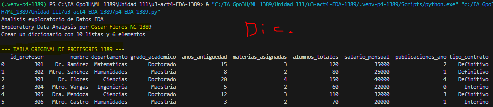
## 💾 2. Convertir el DataFrame en archivo CSV
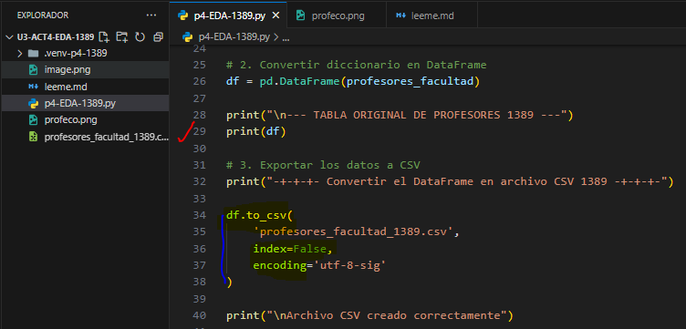
## 📝 3. Crear el diccionario con 10 listas y 6 elementos
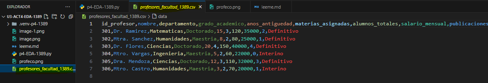
## 📂 4. Leer los datos desde el archivo CSV
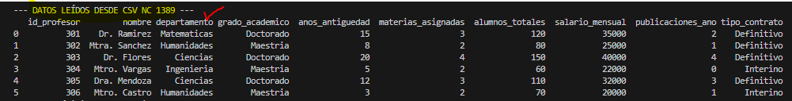
## 🔍 5. Análisis Exploratorio de Datos (EDA)
### Primeros y últimos registros
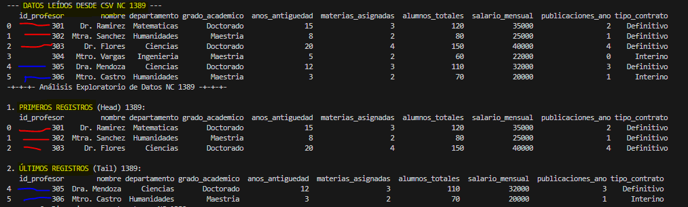
## 6. Dimensiones y estructura
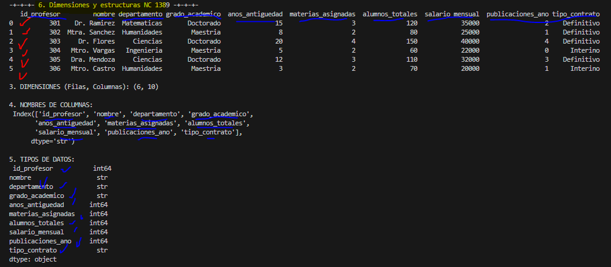
## 7. Estadísticas y limpieza de datos
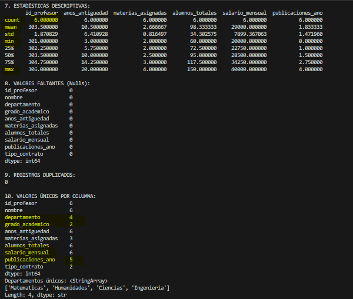
## 8 y 9. Ordenamiento, filtrado y agrupación
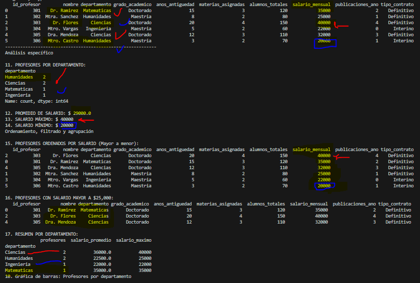
## 10. Gráfica de barras: Profesores por departamento
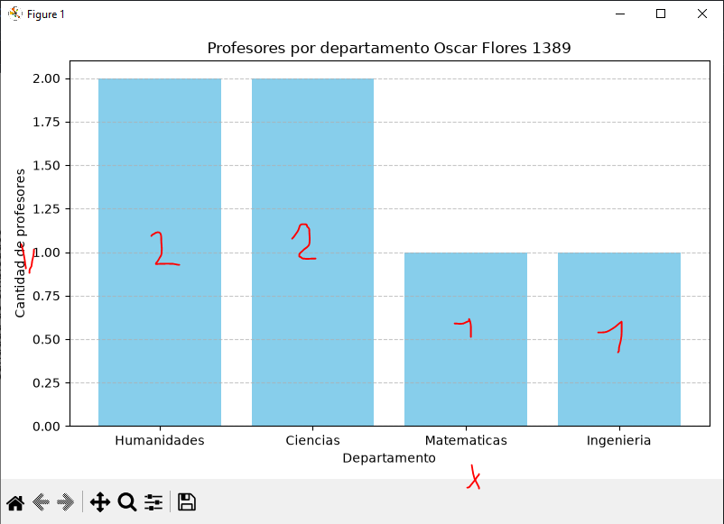
## 11. Gráfica de barras: Salarios por profesor
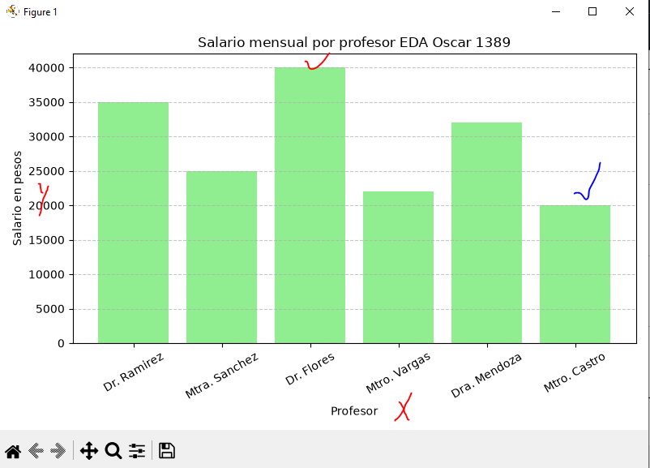
## 12. Histograma: Distribución de años de antigüedad
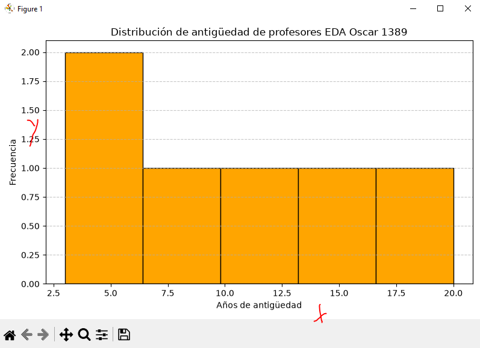
## 13. Gráfica de dispersión: Años de antigüedad vs salario
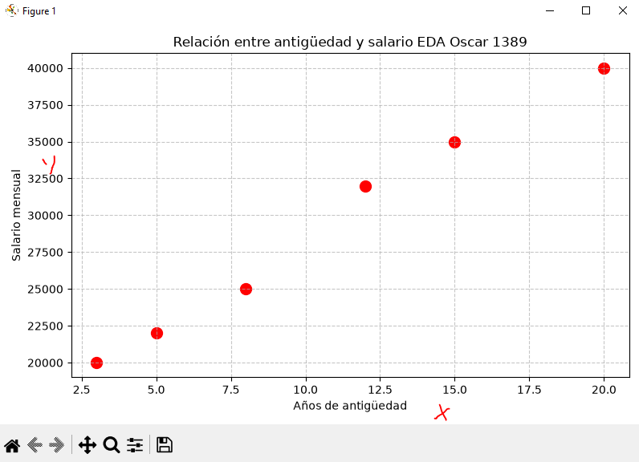
## 14. Diagrama de caja: Distribución de salarios
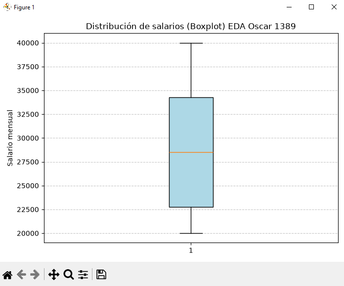
## 15. Matriz de correlación
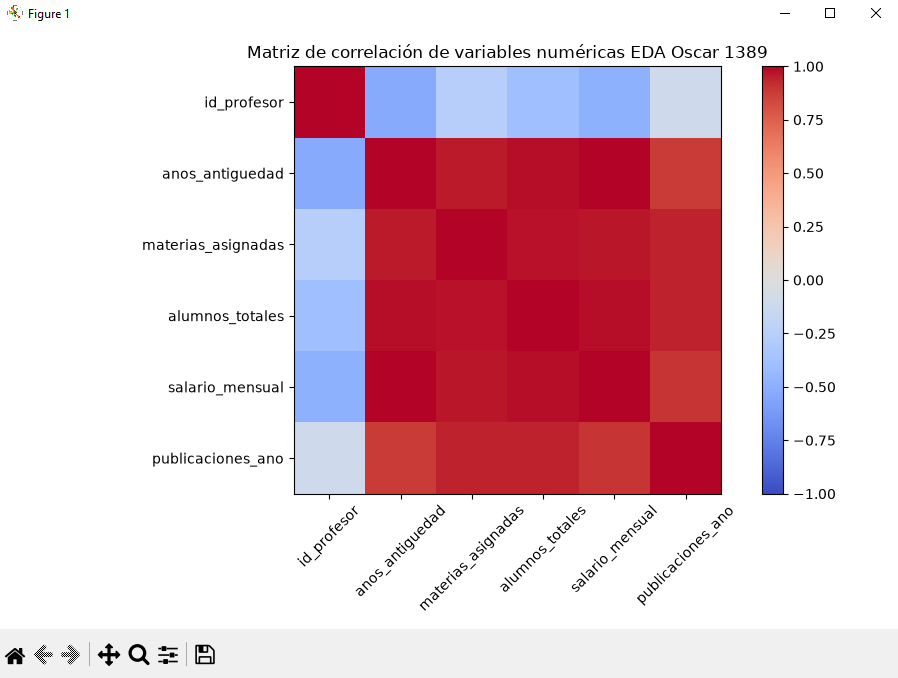
